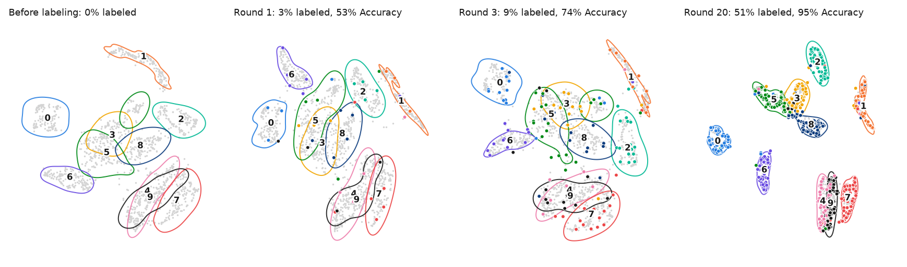
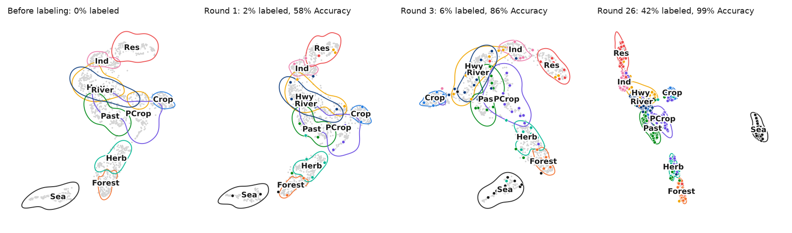
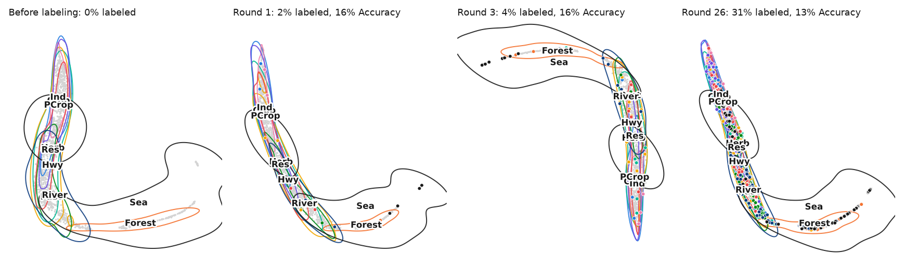

# Image Map Annotation

**A single, standalone Jupyter notebook for annotating an image dataset interactively**, built on [jupyter-scatter](https://github.com/flekschas/jupyter-scatter) and [ipywidgets](https://github.com/jupyter-widgets/ipywidgets). It runs in JupyterLab, VS Code and Google Colab.

Use it when you have images and their embeddings (CLIP, DINOv2, ResNet or plain pixels) and want to:
1. label them for a classifier with as few labels as possible;
2. find out what an unlabeled collection contains.

What the notebook does:
1. Builds a 2D map of the embeddings, where similar images sit together.
2. Asks you to label a well-spread set of images by clicking, one per grid cell on the map.
3. Predicts labels for the rest, and points the next round at the images it is least sure about.

**TLDR.** Each image's feature vector is projected to 2D with UMAP. A grid is laid over the map and you label one image per grid cell, so every region of the collection gets labels, including rare-looking images that a random sample would miss. A linear classifier trained on your labels predicts the rest; from the second round on, each grid cell offers the image the classifier is least sure about. After each round the map is recomputed from your labels only (semi-supervised UMAP). You stop when the predictions look right.

## Examples

The following figures come from running the notebook's workflow. Each shows the map before labeling and after three stages of labeling. Gray dots: unlabeled; colored dots: labeled; contours: true classes; accuracy: the share of unlabeled images the classifier predicts correctly.

### MNIST, raw pixels

The notebook's built-in example: 1,500 handwritten digits (150 per digit), described by their grayscale pixel intensities. As labels accumulate, the digits separate on the map.

### EuroSAT satellite images: the features matter

1,500 EuroSAT satellite tiles (10 land-cover classes, 150 each), with two kinds of features.

With embeddings from the DINOv2-small vision model, the map is structured before any labeling. Prediction accuracy increases as more of the images are labeled.

With raw pixels, the same images form a thin band ordered by brightness, and only Sea and Forest separate. More labels barely help: predictions stay close to chance.

Class names: Res = Residential, Ind = Industrial, Hwy = Highway, Crop = Annual crop, PCrop = Permanent crop, Past = Pasture, Herb = Herbaceous vegetation.

## Usage

### Input

- A folder of images (`IMAGE_DIR`).
- A DataFrame `images_df` with one row per image:

| column | content |
|---|---|
| `image` | file name inside `IMAGE_DIR` |
| `features` | a 1D array per image, all the same length |
| other columns | kept as metadata; any of them can color the first map (`COLOR_BY`) |

### Run the notebook

Run the cells from top to bottom, then repeat steps 2b to 2d until the predictions look right.

### Output

Written to `OUTPUT_DIR`:

- `labels.csv`: `image, label` for every image you labeled. Saved on every click.
- `predictions.csv`: `image, label, predicted, confidence` for every image. `confidence` is the classifier's probability for the predicted class (1.0 for images you labeled).

## Resources

- jupyter-scatter: [documentation](https://jupyter-scatter.dev)
- ipywidgets: [documentation](https://ipywidgets.readthedocs.io)
- UMAP: [umap-learn documentation](https://umap-learn.readthedocs.io), [semi-supervised UMAP](https://umap-learn.readthedocs.io/en/latest/supervised.html)
- Widgets on Colab: [custom widget support](https://colab.research.google.com/notebooks/widgets.ipynb)
- MNIST: LeCun, Cortes & Burges, [dataset page](http://yann.lecun.com/exdb/mnist/)
- EuroSAT: Helber et al., [EuroSAT RGB on Zenodo](https://zenodo.org/records/7711810)
- DINOv2: Oquab et al., [facebook/dinov2-small](https://huggingface.co/facebook/dinov2-small)
